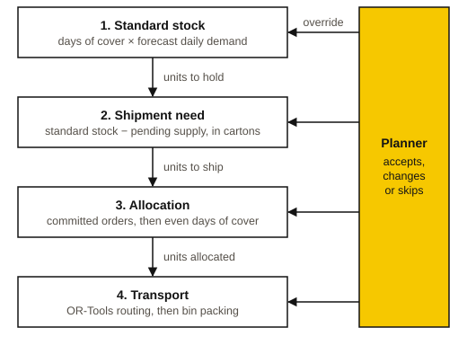

Kalbe Farma · acting Data Science Lead · lead builder, with a small team. **Status:** in client acceptance testing.

## Problem

A pharmaceutical distributor restocks its branches from a few distribution centres. Planners do it
by hand in a spreadsheet: how much each branch should hold, how much to ship today, which centre
fills it, and which truck carries it.

The sheet works, but it is slow, it lives in one person's head, and nobody can see why a number is
what it is. The planners wanted a tool they could use every morning instead, and they would keep
the final say on every quantity.

## Constraints

- **Planners decide.** The tool recommends and explains, and every figure can be overridden.
- **The method has to match the data that exists.** There were no order or holding costs, so
  textbook cost-optimal policies had nothing to optimise against.
- **Stock is shared.** When a centre cannot cover every branch, someone has to go short, and the
  rule for who goes short must be fair and explainable.
- **Trucks have limits.** These include volume, payload, temperature class, region and vehicle size.
- **Plans must reproduce.** The same morning's data must give the same plan on any machine.

## Approach

The planner runs in four stages per branch and product, and each stage consumes the one before.

| Stage | Question | Method |
|---|---|---|
| 1. Standard stock | How much should the branch hold? | Days of cover times forecast daily demand |
| 2. Shipment need | How much should we ship now? | Standard stock minus all pending supply, rounded to cartons |
| 3. Allocation | Who gets scarce stock? | Committed orders first, then raise branches together toward the same days of cover |
| 4. Transport | Which truck, in what order? | Vehicle routing with pickup and delivery, then bin packing |

**Coverage days as the policy.** With no cost data, days of cover is the
parameter the business already maintains and understands. Safety stock is what remains of that
cover after lead time and a shipping buffer.

**Count pending supply once.** Stock in transit, on hand, and committed but not yet released are
each counted once, so goods on a truck are never ordered twice.

**Even fill for allocation.** When stock is short, branches are raised together toward the same
days of cover, like water finding one level, so the shortfall spreads evenly and the rule fits in one sentence. Allocation needs no
solver.

**Routing that sheds the right freight.** The routing model (OR-Tools) treats each delivery as
optional, with a drop penalty that grows with priority and volume. If trucks cannot carry
everything, the solver drops the lowest-priority freight first. The search stops after a fixed number
of solutions instead of a fixed time, so plans reproduce across machines.

**Every number explains itself.** Each figure carries a generated sentence naming its terms. A
planner's override is kept beside the engine's figure, and every accept, change or skip is stored
with who and when.

## How I knew it worked

- **Invariants under test.** For example, allocated plus unserved equals demand, and no gap goes
  below zero. The suite has over a thousand tests.
- **Pinned expected outputs** for one frozen day of data, so any change to a formula shows
  up as a difference someone has to accept.
- **Daily data checks.** Each morning's data passes plausibility checks before the planner sees
  it. A hard failure blocks the day, and a soft one flags the row.
- **Timing budgets.** Opening a screen and re-planning after an edit each have a budget, measured
  with a ten-user load script.

The planners' rules were copied line by line into a table beside the engine's rules. That is weaker than
matching the numbers in their workbook, and no planner has run a real day on it yet, so
there is no savings claim.

## What I'd change

- **Match the spreadsheet's numbers early.** A numeric match on a handful of real days would have found
  disagreements faster than reviewing rules.
- **Ask for the missing inputs in week one.** Fleet per centre, vehicle costs and carton sizes are still
  placeholders, and transport results depend on them most.
- **Model demand uncertainty.** Safety stock comes from a maintained parameter. Deriving it from forecast
  error would size it to the real risk per product.

## Status

In client acceptance testing. The first two stages run on real data; allocation and transport wait
on confirmed fleet and cost inputs.
